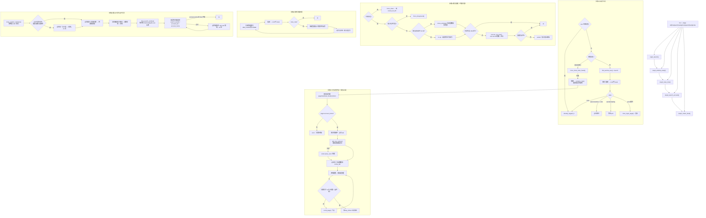
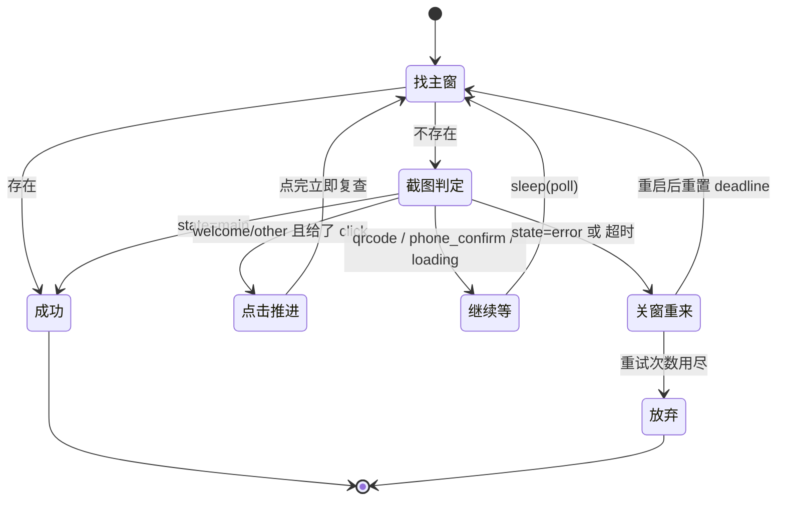
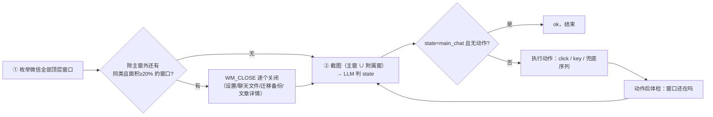
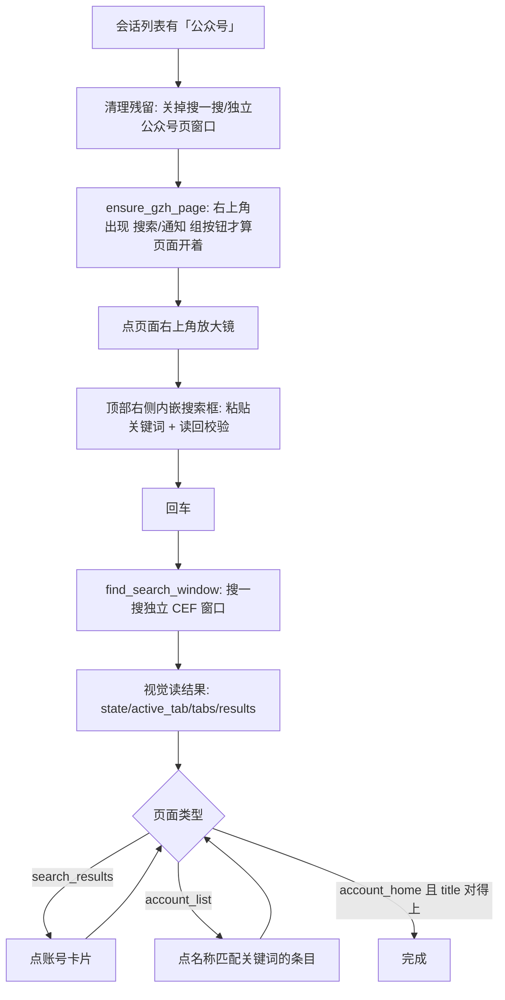
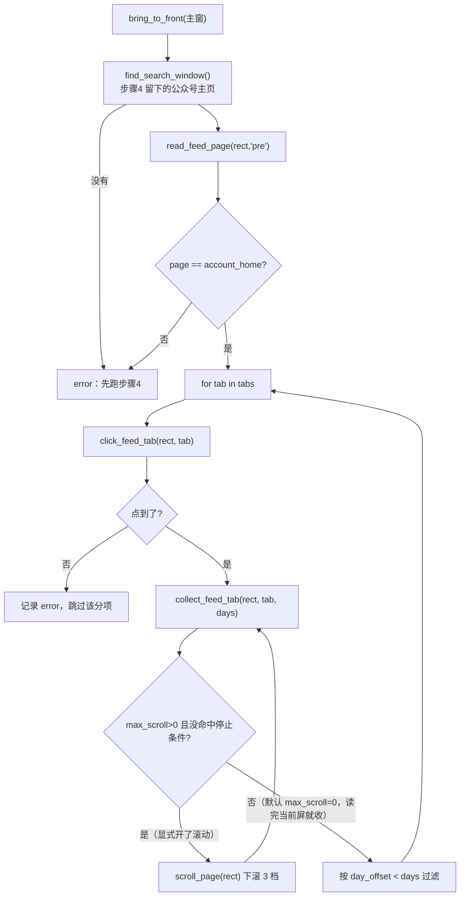
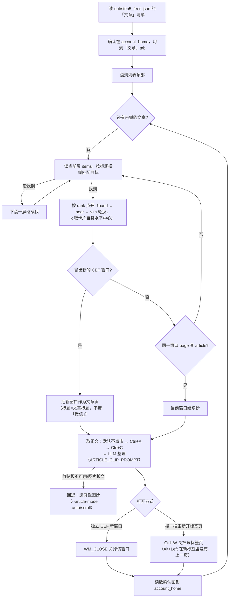
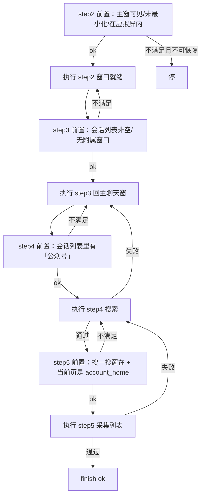

# 微信公众号采集自动化 —— 实施方案与实施记录

- 版本：v0.8
- 日期：2026-11-03
- 本版变更：**定位「UIA 昨天能用今天不能用」的根因 = 启动微信之前本进程已经连过 UIA，微信这个实例就永远不建无障碍树**（§11.30，含 6 组对照矩阵；读屏标志/DPI/启动方式/残留进程全部排除）；`step1_launch` 改成「先纯 win32 启动微信、后连 UIA」，`launch_wechat` 改 ShellExecute + `_UIA_TOUCHED` 警告，新增 `a11y_diagnosis()` 与 `--stage a11y [--fix-a11y]`，step1/step2/step4/前置判定改为报真实原因；**步骤 5 默认只采「文章」且 `--max-scroll 0`（只读当前屏不滚动）**，视频号改为显式开启；步骤 6 修三处（§8.8）：抄前 `_scroll_to_top()` 归位（CEF 记得上次滚动位置，不归位会从文末抄起）、收尾改用 **`Ctrl+W` 关标签页**（点开文章其实是搜一搜新开标签，`Alt+Left` 退不回去）、`page=article` 时绝不再 `scroll_page` + 每篇开始前确认在主页；`--article-max-scroll` 默认 8→16、新增 `--article-scroll-notches`（6）与字符级重叠合并（`_merge_paragraphs`/`_overlap_cut`/`_prefix_dupe`，单测 `tests/test_merge_paragraphs.py`）；**取正文改为剪贴板路线**（点正文区空白 → `Ctrl+A` → `Ctrl+C` → `llm_text_json` 整理，`--article-mode` 默认 `clipboard`；实测 5563 字原文 → 4550 字正文 / 131 段、零滚屏，逐屏截图降为回退），`click_article` 找文章的滚动量改为**自动跟随步骤 5 的 `max_scroll`**（`--article-find-scroll` 默认 -1，找前先 `_scroll_to_top` 归位；步骤 5 落盘新增 `max_scroll`，实测 `ok 2/4` → `4/4`），`_salvage_strings()` 抢救被 token 截断的 JSON；**复制正文不再默认点击**（点正文区 45% 会点到配图弹出大图预览、`Ctrl+A` 失效；改成 `no_click → esc_no_click → title_click` 三策略，实测不点一次拿 12628 字）；步骤 5 新增**窗口闭合判定**（`window_open` / `window_warning` / 落盘 `scrolled`）与 `--feed-fill-window`（窗口没闭合就自动补滚一屏，最多补 6 屏；实测 `--days 1` 只读当前屏 `seen=1` 漏采，补滚后 `seen=2` 全采到）；**修三处定位/点击缺陷**（21:25–21:37 实测）：① `tab_row_centers` 聚类后先丢贴边簇（窗口左暗边 + 右滚动条被数成第 5 簇 → 切「文章」分项连点 3 次失败，修后 `pixel` 一次命中）；② 清单过滤合集折叠条（`FEED_CHROME_RE` + `FEED_PROMPT` 两层，实测「2个内容」被当文章导致步骤 6 点不开，计入 `dropped_chrome`）；③ 点文章卡片的 x 改由 `_card_center_x()` 取卡片自身水平中心（`pick_click_point(card_x=True)`；主页卡片内缩约 200px，固定 `crect[0]+140` 点到左边空白槽，实测 `ok 1/2` → `2/2`，`band#0` 一次点中不再靠 `vlm` 兜底）；`clipboard.via` / `attempts` 补上落盘；④ **「置顶」条目不再当最近内容**（`PINNED_LABELS` / `_next_header_offset()` / `dropped_pinned_older`；实测长安汽车今天没发文章，置顶的星期六旧文被当今天的文章送去步骤 6，修后 `kept=0 seen=1 dropped=1`，回归汽车公社仍 `2/2`）
- v0.7：步骤 6（按步骤 5 清单逐篇抓正文，自动关窗口/退回主页）落地（§8.8–8.11，`--stage article`）；新增 `--article-limit` / `--article-max-scroll` / `--feed-json` / `--with-article`；step1 不再"超时杀微信重启"；`find_main_window` 增 HWND 兜底
- v0.6：修 DPI 125% 下"点了不准"（进程 DPI 感知）；步骤 4 截图裁内容列 + 卡片带吸附定位；「视频号」按前 4 条取；切 tab 全范围扫描 + 文字行中心吸附；会话列表自动滚动找「公众号」；搜一搜窗口必须先抬到最前
- 目录约定：根目录只放正式代码（`wechat_*`），**`tests/` 存放临时代码与测试临时文件**（探测脚本、草稿、临时日志/JSON），非生产路径、可整体清空
- v0.5：步骤 5（公众号主页采集「文章 / 视频号」并按最近 N 天过滤）落地并独立成章；流程编排扩到 2→3→4→5；新增 `--stage feed`、`--days`、`--tabs`、`--max-scroll`
- 主程序：`wechat_public_account.py`（本目录）
- 当前覆盖：步骤 1（启动并进入微信）、步骤 2（窗口就绪：可见/非最小化/不越界）、步骤 3（回到正常主聊天窗）、步骤 4（搜公众号并点开主页）、步骤 5（主页采集列表并按天过滤）
- 运行环境：`D:\miniconda3\envs\ufo\python.exe -X utf8`

---

## 1. 设计目标

用「确定性代码 + 视觉 LLM 决策」的混合方式驱动微信 4.x 桌面端，为公众号采集打底。

| 层 | 负责 | 手段 | 特点 |
|---|---|---|---|
| 确定性层 | 进程、窗口、HWND、显示器几何、附属窗口关闭 | pywin32 / pywinauto / psutil | 快、免费、可重跑、结果确定 |
| 视觉层 | 「现在是二维码页还是主界面」「当前是不是主聊天窗」 | 视觉 LLM，只回 JSON | 界面改版不用改代码 |
| 编排层 | 按步骤调上面两层的结论做动作 | `step1_launch` / `step2_window_ready` / `step3_main_chat` / `step4_search_account` / `step5_collect_feed` | 每步截图存档 + 落 JSON |

两条硬约束：

1. **LLM 不直接操作界面**，只输出结构化决策，由代码翻译成点击/按键/关窗，决策可记录、可回放、可断言。
2. **能用 HWND 解决的绝不让模型猜**：关附属窗口、判可见性、算矩形都走 win32；模型只在"画面语义"上决策。

---

## 2. 整体架构



---

## 3. LLM 决策协议（已实现）

三套提示词，同一套字段格式，代码按字段分发。

### 3.1 登录阶段 `STATE_PROMPT`

```json
{
  "state": "welcome|qrcode|phone_confirm|main|loading|error|other",
  "evidence": "图中关键文字（<=20字）",
  "action": {"type": "click|double_click|wait|none", "target": "...", "center_norm": [0.0, 0.0], "double": false},
  "confidence": 0.95
}
```

动作规则（写进提示词，程序照做）：`welcome` 必须给 `click` 指向「进入微信」；`other` 只要画面上有明确按钮也必须给 `click`；`qrcode`/`phone_confirm`/`loading`/`main` 给人处理，`none`。

### 3.2 主聊天窗 `CHAT_PROMPT`

```json
{
  "state": "main_chat|chat_detail|sub_page|dialog|search_panel|blank|other",
  "evidence": "图中关键内容（<=20字）",
  "action": {"type": "click|double_click|key|none", "key": "esc|alt+left", "target": "...", "center_norm": [0.0, 0.0]},
  "confidence": 0.95
}
```

| state | 含义 | 程序默认处置 |
|---|---|---|
| `main_chat` | 左侧会话列表 + 右侧聊天区，无浮层 | 完成，不动 |
| `chat_detail` | 聊天内右侧详情/成员/设置侧栏 | 点左侧「微信」导航 |
| `sub_page` | 通讯录/朋友圈/文章/收藏/设置页/小程序 | 点左侧「微信」导航（UIA 控件点击） |
| `dialog` | 确认框、更新提示、退出提示 | 点安全的「取消/关闭/稍后」 |
| `search_panel` | 搜索下拉结果面板 | Esc（唯一允许发 Esc 的状态） |
| `blank` | 整片白屏，只剩左侧导航图标 | 立即点左侧「聊天」图标 |
| `other` | 判断不出 | 兜底序列 |

护栏：严禁点「退出登录/删除/清空聊天记录/立即更新」；**严禁点窗口右上角三个系统按钮**（程序侧还会二次拦截坐标）。

### 3.3 公众号主页列表 `FEED_PROMPT`

字段与用途见 §8.1（`page` / `title` / `active_tab` / `tabs` / `date_headers` / `items` / `bottom_reached`）。与上面两套的区别：它不返回动作，只返回**页面结构化内容**，动作由代码按 `center_norm` + 像素聚类自己算。

### 3.4 字段用途

| 字段 | 程序行为 |
|---|---|
| `state` | 决定是否完成、走哪条兜底 |
| `action.type` | 仅 `click`/`double_click`/`key` 才执行，`none` 一律不动 |
| `center_norm` | 相对整图比例，**优先使用**（抗模型内部缩放） |
| `center` | 像素坐标，备用，按 `原图宽/发送宽` 折算 |
| `confidence` | 只记录，不参与分支（避免低置信直接放弃） |
| `date_label` | 步骤 5 用它换算 `day_offset`，**只信页面原文**，不让模型推算日期 |

---

## 4. 步骤 1：确认微信已启动并进入主界面

入口：`step1_launch(scan_timeout=180, poll=3.0, relogin=1, exe="", dry_run=False)`

| 顺序 | 条件 | 动作 | 结果 |
|---|---|---|---|
| 1.1 | UIA 能找到 `mmui::MainWindow` | 不再启动，读会话列表条数 | `already_logged_in` |
| 1.2 | 进程在、但没有任何可见窗口（缩到托盘） | `force_show_main_hwnd()`；失败再 `reveal_via_llm()` | `logged_in` / `error` |
| 1.3 | 进程不存在 | 注册表 App Paths → Tencent InstallPath → 常见路径 找 `Weixin.exe` 启动，等窗口出现（≤30s） | 进入 1.4 |
| 1.4 | 无主窗但有登录窗 | 每 `poll` 秒截图问 LLM 判 `state` | 见下 |

**关键设计**：进程存在但窗口不可见时**绝不重复启动**，否则会多开/掉登录态，只能唤出。

扫码轮询状态机：



- 每轮先做便宜的 UIA 检测，取不到才付一次视觉调用（关 thinking 后单次约 1s）
- `welcome`/`other` 且模型给了 `click` → 立即点击，点完马上复查主窗，不等 `poll`；同一轮最多点 8 次
- 轮询期间窗口若又缩回托盘，先 `force_show_main_hwnd()` 拉出来（上限 3 次）
- 超时或 `error` 页 → `close_login_page()`：LLM 找关闭按钮 → 不行则 `kill_wechat()` 重启，重来 `--relogin` 次

---

## 5. 步骤 2：窗口就绪（可见 / 非最小化 / 不越界）

入口：`step2_window_ready(dry_run=False)`

| 顺序 | 条件 | 动作 |
|---|---|---|
| 2.1 | UIA 找不到主窗 | `force_show_main_hwnd()`；仍不行 → `reveal_via_llm()` 点任务栏/托盘图标 |
| 2.2 | `IsIconic` 为真或窗口不可见 | `force_foreground()`；失败 → `reveal_via_llm()` |
| 2.3 | 落在虚拟屏内的比例 < 0.98（跑出屏幕，点了会落空） | `move_window()` 拉回到**重叠最多的那块屏**居中 |
| 2.4 | 会话列表 UIA 读不到条目（`session_count == 0`） | `recover_uia_tree()`：发微信热键 `Ctrl+Alt+W` 隐藏→显示，重建 UI 树（见 §11.23） |
| — | 验收 | `onscreen_after >= 0.98` 且会话列表非空 记 `ok`，否则 `partial` |

**刻意不搬到主屏**（2026-11-02 调整）：

- 步骤 3/4 全部按窗口自身矩形取坐标与截图（`grab()` 是抓整虚拟屏再裁剪），窗口在副屏照常能操作；
- 强行搬动会重排微信内部布局（会话列表宽度、公众号卡片流），还会多一次 HWND/UIA 重取，多一个失败点；
- 实测：主窗在副屏 `(2104,150)-(3096,946)`（`on_primary=0.0`、`onscreen=1.0`）时，`--stage flow` 的 2→3→4 一次通过并点到公众号主页；
- 只有"跑出屏幕边界（点不到）"才是必须修的，所以只保留越界拉回逻辑。

其它细节：

- 尺寸能整块放进目标屏就**保持原尺寸**，放不下才缩，最小 700×480
- `move_window(hwnd, [x, y, w, h])`：每轮设置后等 1s 让 Qt 重排稳定，按「宽高误差 ≤24px」判定，最多 3 轮
- 截图一律「整虚拟屏 `ImageGrab.grab(all_screens=True)` → 按虚拟屏原点裁剪」
- 视觉找任务栏图标时先只给主屏截图（托盘在主屏；全屏拼接图会让坐标指到另一块屏），`not_found` 再退回全屏

---

## 6. 步骤 3：回到正常主聊天窗

入口：`step3_main_chat(max_rounds=4, dry_run=False)`，CLI `--stage chat`、`--chat-rounds`

### 6.1 两段式处理：先确定性清场，再视觉判定



**为什么先清场**：设置、聊天文件、聊天记录迁移与备份这些窗口**都有真实 HWND**，`WM_CLOSE` 一关就完，比"截图让模型找 ×"可靠得多。实测模型只能看到画面最前面的那个，叠在主窗后面或被挡住的附属窗口它根本发现不了（第一次跑步骤 3 时，模型把有 2 个附属窗口的界面判成了 `main_chat`）。

**过滤规则**（避免误伤）：只关和主窗同 class（`Qt51514QWindowIcon`）且面积 ≥ 主窗 20% 的窗口；Qt 的 `ToolSaveBits`/`ToolTip`/托盘消息窗/IME 辅助窗一律不碰。

### 6.2 视觉判定与动作

- 截图区域 = 主窗 rect ∪ 其它较大的可见微信窗口（对话框可能比主窗更大），再 clamp 到虚拟屏
- 模型给 `click` → 换算屏幕坐标后点击；给 `key` → 发 Esc / Alt+←
- 模型没给动作，或**同一 state + 同一动作类型连续出现两次**（说明建议无效）→ 按兜底序列升级

兜底序列（每项只试一次，不重复同样的动作）：

```text
1) 点左侧「微信」导航         白屏/停在通讯录等子页面时唯一可靠的手段
2) Alt+←                     返回上一页
3) 点会话列表第一项           把界面重心拉回会话语境
4) 再点一次「微信」导航       最后兜底
```

`blank` 状态特殊处理：不等兜底，直接点左侧「微信」导航（白屏时 Esc 完全无效，会白等一轮）。

**左侧导航用 UIA 控件点，不用坐标**：实测微信把「微信/通讯录/收藏/发现」暴露成 Button 控件（带精确矩形），`descendants(control_type="Button")` 秒回；模型给这一条的坐标常偏 20~40px，所以只要模型点的位置落在左侧导航区（窗口内 `x<75`、`y<半高`），程序就自动改成点 `微信` 按钮本身。

### 6.3 安全护栏（都是实测踩出来的）

| 护栏 | 作用 |
|---|---|
| `_is_system_button_zone()` | 模型给的坐标若落在主窗右上角 90×70 区域（最小化/最大化/关闭），拒绝执行 |
| 禁用裸 ESC | 微信主窗在非搜索面板状态下按 Esc 会**直接把窗口关到托盘**，故只在 `search_panel` 放行，其余状态替换为点「微信」导航 |
| 左侧导航区改走 UIA | 模型坐标落在左侧导航条时，不按坐标点，改为点 UIA 找到的 Button 控件 |
| 动作后可见性体检 | 万一误点把窗口关到托盘，立刻 `force_show_main_hwnd()` 拉回来再继续 |
| 每轮 `wechat_hung()` | 微信 `IsHungAppWindow=True` 时立即中止并报错，不继续点、不继续问 UIA |
| `close_side_windows` 白名单 | 只关同类且够大的窗口，不碰 Qt 浮层 |

### 6.4 判定"是否在主聊天窗"的证据

- 强证据（视觉）：左侧会话列表 + 右侧聊天区，且无浮层/无其它页面
- 辅助证据（UIA）：`session_list` 列表项数量（本机实测 11 条）
- 结构证据（win32）：微信顶层窗口只有主窗（附属窗口已被 6.1 关掉）

三者不一致时以视觉判定为准，UIA 数量只作为诊断信息落盘。

---

## 7. 步骤 4：搜公众号并点开主页

入口：`step4_search_account(keyword, open_first=True, dry_run=False)`



关键点：

- **先清残留**：搜一搜窗口会跨运行存活，带着上次的 tab/主页状态，搜索前先 `close_residue_windows()` 关掉（见 §11.22），保证每次都是新窗口；
- **搜索入口**：公众号页面右上角放大镜（不是左侧全局搜索框）；
- **结果窗口**：`Chrome_WidgetWin_0` 独立窗口（默认在副屏），微信失焦即关，必须同一次运行里读完；**认窗口只能按进程名 `WeChatAppEx.exe`**（见 §11.24），别按窗口类/标题；
- **读结果**：CEF 无 UIA 内容，一律截图 + 视觉模型（`RESULT_PROMPT` 取结果，`OPEN_PROMPT` 判页面类型）；
- **点开**：默认就点（`--no-open` 关闭）。点开后必须校验 `page=account_home` 且 `title` 与关键词匹配，不匹配就 `Alt+Left` 回退重找，最多 4 轮；
- **dry-run**：只校验到「公众号页面开着 + 搜索框能定位」，不输入、不回车、不点开（残留清理也只看不关）。

返回字段（落盘 `out/step4_search.json`）：`residue`（清掉的窗口清单）/ `gzh_page` / `typed` / `text_verified` / `search_window` / `read_all` / `results`（账号条目在前）/ `open_account`（`ok`、`page`、`title`、`rounds`、`hops`）/ `result`。

---

## 8. 步骤 5–6：读「文章」列表（默认只取当前屏，按天过滤）→ 逐篇抓正文

入口：
- 步骤5 `step5_collect_feed(days=1, tabs=("文章",), max_scroll=0, dry_run=False, video_limit=4)`，CLI `--stage feed`、`--days`、`--tabs`、`--max-scroll`、`--video-limit`；
- 步骤6 `step6_collect_articles(limit=5, max_scroll=16, dry_run=False, feed_json="", step_notches=6, article_mode="clipboard", find_scroll=0)`，CLI `--stage article`、`--article-limit`、`--article-max-scroll`、`--article-scroll-notches`、`--article-mode`、`--article-find-scroll`、`--feed-json`。

**默认行为（2026-11-03 定）**：只采「文章」一个分项，且 `max_scroll=0` —— **只读当前屏幕上能看到的那几篇，不做任何下滚**（`stop="只取当前屏（max_scroll=0）"`）。要历史内容显式给 `--max-scroll N`；要视频号显式 `--tabs 文章,视频号`（视频号卡片没有日期分组，按 `--video-limit` 取前几条）。

**按时间窗口采集（步骤 5+6 组合用法）**：`--days N` 就是时间窗口，步骤 6 直接吃步骤 5 落盘的清单，所以一条命令搞定：

```
# 推荐：开 --feed-fill-window，让步骤 5 自己滚到窗口边界为止（不用手算 --max-scroll）
... wechat_public_account.py --stage all --keyword 汽车公社 --days 1 --feed-fill-window \
        --with-article --article-limit 5
# 或者手工给滚动量
... wechat_public_account.py --stage all --keyword 建约车评 --days 2 --max-scroll 4 \
        --with-article --article-limit 5
```

- 窗口边界靠日期分组判定：`day_offset < days` 才留，滚动时**碰到更早的分组立即停**（实测 `--days 2`：`seen=3 / kept=1 / dropped=2 / stop=已到比目标天数更早的内容`，「星期五」那两条被丢）；
- `--days 1` 而窗口内没文章时，步骤 6 不会瞎抓，直接报「没有文章清单：步骤5 的「文章」分项在当前 --days 范围内没内容（加大 --days 重跑步骤5，或用 --feed-json 指定别的清单）」；
- **默认只读当前屏会漏采，任何 `--days` 都一样**：窗口里的文章多于一屏就取不全（实测 `--days 2 --max-scroll 0` → `seen=1`，给 `--max-scroll 4` → `seen=3`；`--days 1 --max-scroll 0` → `seen=1`，开 `--feed-fill-window` → `seen=2`，今天那 2 篇都在）。所以按时间窗口采集**建议开 `--feed-fill-window`**：它只滚到窗口边界为止（碰到更早的分组立即停），不会滚到底。



### 8.1 读数：先裁内容列，再让模型结构化

`read_feed_page()` = `grab(窗口矩形)` → `content_crop()` → `llm_json(FEED_PROMPT)`，模型只回 JSON：

```json
{
  "page": "account_home|account_list|search_results|other",
  "title": "公众号名称",
  "active_tab": "全部|贴图|文章|视频号",
  "tabs": [{"name": "文章", "center_norm": [0.0, 0.0]}],
  "date_headers": [{"label": "今天|昨天|星期五|10月30日", "center_norm": [0.0, 0.0]}],
  "items": [{"title": "...", "date_label": "所属分组", "kind": "文章|视频|贴图|其他", "extra": "阅读数等", "center_norm": [0.0, 0.0]}],
  "bottom_reached": false
}
```

**`content_crop()` 是必需步骤，不是优化**（见 §11.25）：整窗喂模型时坐标误差可达 600px，裁到内容列后降到 ~50px。

### 8.2 切分项：像素聚类优先，模型坐标兜底

| 顺序 | 手段 | 判据 |
|---|---|---|
| 1 | `tab_row_centers(img, y_hint)`：**全范围扫描** y ∈ [0.08h, 0.62h]，取灰度行里 **恰好 4 个**文字簇、间距 20~160px 且基本均匀的那一行，再按距 `y_hint` 取最近 | 命中 → `via="pixel"` |
| 2 | 用模型给的 `center_norm` 换算屏幕坐标 | 命中 → `via="vlm"` |
| — | 点击后重新读数校验 `active_tab == tab`；不对就重试（默认 3 轮） | 全部失败 → 该分项记 `error` |

三个坑（都是实测踩出来的）：

- **不能只扫 y_hint ±45px**：模型给的 tab y 常差 100~200px（实测主页 tab 在 y=415，模型报 0.28×816≈228），窗口一改尺寸就整行错过 → 改为全范围扫描；
- **y 必须吸到文字行中心**（`_text_row_extent`）：直接返回命中的扫描线 y 会落在 tab 文字上方十几像素的空白里，点下去毫无反应；
- **贴边的深色带要先丢掉**（2026-11-03 21:25 实测）：窗口左边缘的暗边（x≈0–8）和右侧滚动条（x≈1223）各算一个簇，分项行被数成 **5 簇 ≠ 4** → `tab_row_centers` 返回空、退回模型坐标点偏，连点 3 次 `active_tab` 仍是「全部」。现在聚类后先过滤 `s ≤ 12 or e ≥ w-12` 的贴边簇（真正的分项文字不会贴边）；修完离线复现同一张图 `centers=[365,429,502,586]`，实跑 `点分项「文章」第1次（pixel）` 一次命中。

已在当前分项时直接 `already=True` 跳过点击。

### 8.3 日期分组 → 距离今天几天

`parse_day_offset(label)` 支持：`N分钟前`/`N小时前`（0）、`今天`（0）、`昨天`（1）、`前天`（2）、`星期X`（按最近的过去推算）、`M月D日`（当年，跨年自动 +1 年）、`YYYY年M月D日`。解析不出返回 `None`。

### 8.4 滚动与停止

- **默认完全不滚**（2026-11-03 要求）：`--max-scroll 0` → 只读当前屏一轮就收，`stop="只取当前屏（max_scroll=0）"`；循环里 `i >= max_scroll` 直接 `break`，**不会调用 `scroll_page`**，列表位置保持原样（步骤 6 紧接着在同一位置点开文章）；
- 显式 `--max-scroll N` 才下滚：`scroll_page(rect, notches=3)`，光标移到窗口内 → `MOUSEEVENTF_WHEEL`，每档 -120，档间 0.15s，末尾等 1.3s 让卡片流渲染完；
- 滚动态下三个停止条件任一命中即停：① 读到 `day_offset >= days` 的条目（已越过目标时间窗）；② 模型回 `bottom_reached`；③ 前后两轮截图缩到 160×160 后灰度平均差 < 1.0（滚不动）；滚到 N 次上限则 `stop="滚到 max_scroll 上限"`。

### 8.5 去重与过滤

- 去重 key = 条目标题（`seen` 字典），滚动过程中重复出现只保留首次；
- **「置顶」分组里的条目按它下面第一个日期分组判日期**（`PINNED_LABELS` / `_next_header_offset()`，计入 `dropped_pinned_older`）：置顶卡片上**没有发布时间**，只有「置顶」标签，`parse_day_offset("置顶")` 返回 `None` → 原先按「未知日期一律保留」被收进清单。实测（2026-11-03 21:44 长安汽车）**今天没发文章**，第一屏是「置顶」+「星期六」，那条置顶旧文被当今天的文章送去步骤 6（点开一篇窗口外的文章，还是图片长文 → 正文 0 字）。现在置顶条目借「它下面第一个日期分组」定日期，超出 `--days` 就不进清单；模型若直接把下一条的分组标签（如「星期六」）抄给它，也会被普通日期过滤挡掉（实测 `kept=0 seen=1 dropped=1`）；
- **丢掉「不是文章」的条目**（`FEED_CHROME_RE`，计入 `dropped_chrome`）：合集/专辑折叠条（实测「**2个内容**」）、`查看全部 / 查看更多 / 展开全部 / 更多` 这类控件文字。视觉模型会把它们当条目读进清单，步骤 6 点不开（实测报「没能在文章列表里点开这篇」）；`FEED_PROMPT` 里也同步加了「不要把折叠条/控件/分组标签当条目」这条，两层都上；
- 保留 `day_offset is None or day_offset < days`（**未知日期一律保留**，宁多不漏，用 `unknown_date` 计数提示人工复核）；
- **窗口有没有闭合**（`window_open`）：这一屏**最下面一条**仍在窗口内、且本轮没出现超出窗口的分组 → `window_open=true`，说明窗口内容延伸到屏幕底部、下面可能还有，落盘会写 `window_warning` 提醒清单可能不完整。分组标签也参与判定（`--days 1` 时屏幕上出现「昨天」就等于窗口过完，实测少判这条会白多滚一屏）；
- **`--feed-fill-window`**：`window_open` 时**自动多滚一屏**再读，最多在 `--max-scroll` 之外补 `FILL_WINDOW_EXTRA=6` 屏，补了几屏记 `auto_extend`。实测 `--days 1` 只读当前屏会漏——今天有 2 篇、当前屏只显示 1 篇（`seen=1` → 补滚后 `seen=2`）；
- 落盘 `scrolled = max_scroll + auto_extend`：步骤 6 找文章的滚动量按这个值走（清单实际跨了几屏）。
- 每轮回读一条 `rounds` 记录：`shot` / `items` / `fresh` / `headers` / `bottom_reached`。

**视频号已改为默认不采**（2026-11-03 要求；原先的例外规则见下）：视频号卡片上**没有日期分组标签**，没法按天筛，
所以显式 `--tabs 文章,视频号` 时它走「按条数取」模式——只取列表最前面 `--video-limit`（默认 **4**）条，
取够就停、不往下滚。`collected.视频号.limit` / `stop="已取到前 4 条"` 可核对。

**步骤 6 不会拿视频号顶替文章**：`load_step5_items()` 只要看到 `collected` 里有「文章」这个 key，就只认它的
`items`（为空就是"这段时间没有文章"，直接报 `没有文章清单：…当前 --days 范围内没内容`）；只有清单里
根本没有「文章」键（老文件）才退化去取别的分项。实测踩过：`days=1` 时文章 0 条，退化拿了视频号标题去
文章列表里找，必然「没能在文章列表里点开这篇」。

### 8.6 返回字段（落盘 `out/step5_feed.json`）

`account` / `page` / `search_window` / `days` / `tabs` / `max_scroll` / **`scrolled`**（`max_scroll + auto_extend`，步骤 6 靠它决定找文章要滚几屏，见 §8.8）/ `window_warning`（窗口没闭合时提醒清单可能不完整）/ `collected{分项: {click, rounds, items, total_seen, dropped_older_than_days, dropped_chrome, dropped_pinned_older, unknown_date, window_open, auto_extend, stop}}`（条目本身带 `pinned` 标记）/ `total` / `events` / `result`（至少一个分项切进去记 `ok`）。

### 8.7 与流程编排的关系

- `--stage flow` 现在是 **2→3→4→5**，步骤 5 的前置是 `precheck_feed()`：搜一搜窗口在 + 当前页是 `account_home` + 能看到分项标签；
- 前置不满足 → 回退步骤 4 重开主页（`recoverable=True`）；
- 采集本身失败（某分项没切进去）**不算流程失败**：`plan` 里步骤 5 的通过条件是 `result in ("ok","partial")`；
- `--stage all` 带 `--keyword` 且没加 `--no-open`/`--dry-run` 时，步骤 4 之后自动接步骤 5；再加 `--with-article` 才继续跑步骤 6。

### 8.8 步骤 6：按清单逐篇打开抓正文



关键点：

- **清单来源**：`load_step5_items()` 默认读 `out/step5_feed.json` 的 `collected.文章.items`（没有就退化为任意分项），所以步骤 6 可以脱离步骤 5 单独跑；`--feed-json` 可换别的文件；
- **文章可能是新窗口**：微信点文章常常另开一个 `Chrome_WidgetWin_0` 窗口，**标题就是文章标题**（不含"微信"），所以 `cef_windows(title_filter=False)` 才认得出它；点击前后各取一次 HWND 集合，差集里面积最大的就是文章窗口；
- **认错窗口要收尾**：新窗口开着但标题对不上（点歪到别的卡片）→ 立刻 `WM_CLOSE` 掉再换策略，避免窗口越开越多；
- **点开文章 = 搜一搜里新开标签页**（2026-11-03 实测）：窗口顶部是一排浏览器式标签（`建约车评-搜一搜 | 建约车评 | 「建约车报 11.02…」×`），**还是同一个 HWND**，所以 `classify_search_page` 只看到 page 从 `account_home` 变 `article`，容易被当成"同窗口跳转"。收尾必须 **`Ctrl+W` 关标签**（`close_article_tab()`）：`Alt+Left` 在新标签里没有上一页，连按 3 次仍停在文章里（实测 `back_page=article, back_tries=3`）；`Ctrl+W` 一次就回 `account_home`。真另开独立 `Chrome_WidgetWin_0` 窗口的情况仍走 `WM_CLOSE`；
- **抄之前先归位**（`_scroll_to_top()`）：CEF **记得同一篇文章上次的滚动位置**——上一轮在文章页里滚到底，这次点开同一篇直接落在文末，第 0 轮就 `bottom_reached=true`，只抄到文末二维码/合集目录/上一篇（81 字，当时误判成"图片长文"）。现在先 `Ctrl+Home` 再上滚到画面不变，结果里记 `to_top={home_key, up_scrolls}`；
- **在文章页里绝不乱滚**：`click_article()` 每轮读数若已是 `page=article`（其实点开了，只是标题没对上或模型没列卡片）就直接返回 `via=already_article`，**不再 `scroll_page`** —— 否则会把文章滚到底、污染下次的滚动位置（14:28 那次 10 轮空滚就是这么来的）；
- **每篇开始前确认还在主页**：`read_feed_page` 不是 `account_home` 就中断（写 `res.error` + `ev("中断")`），绝不在文章页里继续点；
- **列表位置会变**：每篇抓完回来，列表滚动位置不确定，所以每次找目标都重新读数 + 必要时下滚，不缓存坐标。
- **点开成功只看 `page=article`，不看窗口标题**（2026-11-03 修）：微信文章页的窗口标题常常是**公众号名**（实测 `page_title='建约车评'`）或「合集·目录」，拿它跟步骤 5 的标题做硬匹配会把已经点开成功当成失败，然后一路下滚找"没找到的那篇"，越找越偏（实测 10 轮全 `found=False`）。现在 `click_article` 只要 `page=article` 就返回成功，并记 `title_matched` 供参考，标题对不对由正文抓取阶段自己核对。
- **更正：「建约车报 11.02」不是图片长文**，是超长清单文。之前那个 `chars=81` 是**滚动位置后遗症**，不是文章没文字；
- **正文默认走剪贴板，不滚屏、也不点击**（2026-11-03 改，`--article-mode` 默认 `clipboard`）：`Ctrl+A` → `Ctrl+C` → 读剪贴板 → LLM 整理，按 `no_click → esc_no_click → title_click` 三策略递进（详见 §8.9）。实测一次拿到 **5563 字**原文，整理出 **4550 字 / 131 段**正文；逐屏截图路线 15 轮才 4222 字、还带 3 个缺口，耗时 ~3 分钟 vs ~40 秒；
- **找文章的滚动量跟着步骤 5 走**（`--article-find-scroll` 默认 **-1=自动**）：步骤 5 默认只取当前屏时**不滚**（清单就在当前屏，滚了只会把列表推走、下一篇又找不到——实测第六步因此连滚 10 轮）；但步骤 5 一旦按时间窗口滚过（如 `--days 2 --max-scroll 4` 收了 4 篇），列表已停在第 4 屏，不滚就只点得到当前屏那 2 篇（实测 `ok 2/4`，后两篇报「当前屏没找到这篇」）。现在步骤 5 把 `max_scroll` 落盘，步骤 6 用 `load_step5_meta()` 读回来，**先把列表归位（`_scroll_to_top`）再逐屏往下找**，最多滚同样几屏 → 实测 `ok 4/4`；
- **点卡片的 x 用「卡片自己的水平中心」，不是内容列左偏移**（2026-11-03 21:37 修）：`pick_click_point` 原先一律取 `crect[0] + 140`——那是给**搜一搜结果页**定的（卡片贴左、右侧有「上次使用 / N个朋友关注」要避开）。但**公众号主页的文章卡片是内缩的**，左边有约 200px 白边，`crect` 又常常裁不动（主页整片是白底，`content_crop` 找不到更窄的内容列），于是 x 落在**卡片左边的空白槽**里：实测 `band#0`/`near#0` 点在 (273,758) 毫无反应，`vlm` 点 (749,693) 又正好在配图外沿，连点 3 次 `page` 仍是 `account_home`，下一屏还翻过了头。现在 `click_article` 传 `card_x=True`，由 `_card_center_x()` 在该卡片带内取「最宽一段非白区」的中心（离线在同一张截图复现：旧 x=140 → 新 x=616，屏幕坐标 749 落在配图内）→ 修完 `band#0 (749,758)` **一次点中**，第二篇 `near#1 (749,905)` 也一次点中，不再依赖 `vlm` 兜底；
- **真正的图片长文**（正文整版是图）：剪贴板里只有「图片」占位行 → `cleaned.is_image_article=true`、正文为空，需要 OCR 路线（未实现）。这种文章才需要 `--article-mode auto`（回退逐屏截图，能抄到图里的文字时有效）。实测例子（2026-11-03 长安汽车「销量快报 | 长安汽车10月销量23.38万辆…」）：点开正常（`via=vlm`、`title_matched=true`），剪贴板拿到 679 字，但整理后只剩 23 字、`dropped=["图片占位","留言区","互动按钮"]` → 最终 `chars=0`，`stop=剪贴板路线没拿到可用正文`（如实报告，不是抓取失败）。

### 8.9 取正文：默认剪贴板（不滚屏），逐屏截图只作回退

**路线一（默认，`--article-mode clipboard`）— 一次拿全文，全程零滚动**

```
grab_article_clipboard(rect, hwnd)
  1. 备份用户原剪贴板；每次尝试前先写入哨兵 __WXCLIP__<策略名>（确认复制真发生了）
  2. 按「代价从小到大」试三种策略，成功即停（记进 clipboard.via / clipboard.attempts[]）：
       no_click     —— 完全不点，只把窗口抬到前台就 Ctrl+A/Ctrl+C
       esc_no_click —— 按一次 Esc（清掉残留选区/预览）再复制，仍不点
       title_click  —— 点标题行（窗口高度 10% 处，**纯文本，点不出图片预览**）再复制
  3. Ctrl+A → Ctrl+C → 读 CF_UNICODETEXT（结束后还原用户剪贴板）
clean_article_text(text) → llm_text_json(ARTICLE_CLIP_PROMPT + 原文)
  去外壳（简介/口号、「图片」占位与图片文件名、试用申请与网址、留言区），正文原句照抄 → paragraphs[]
```

**为什么不点击**（2026-11-03 改）：原来固定点正文区 45% 高度处，那个位置很容易落在**配图**上——微信文章里点图片会**弹出大图预览**，页面离开文章页，`Ctrl+A` 就废了（「汽车公社」那篇 45% 处正好是主配图，实测踩到）。而 CEF 标签页抬到前台时**文档本来就有键盘焦点**，实测**完全不点**一次复制到 12628 字。所以默认不点，只有复制失败才退去点标题行。

实测（2026-11-03）：原文 **5563 字 → 整理后 4550 字 / 131 段**，`dropped=["图片占位","公众号简介/口号","试用申请/登录官网","留言区/评论提示"]`，约 40 秒，**一次滚动都没有**（逐屏路线 15 轮才 4222 字 + 3 个缺口 + ~3 分钟）。

两个坑：

- **`llm_text_json` 的 token 要给够，还要能抢救**：整理后的输出比输入还长，`max_tokens=4000` 会把 JSON 截断 → 整个对象解析失败、正文全丢（实测 `clipboard.ok=true` 但 `chars=0`）。现在默认 **8000**，且 `_salvage_strings()` 会从截断的 `"paragraphs": [` 里逐个救回已生成的完整字符串（记 `cleaned.salvaged=true`）；
- 纯文本调用是另一条 payload：`messages[].content` 直接放字符串；`llm_json` 用的是 `[{text},{image_url}]` 数组，两者不能混用。

**路线二（回退，`--article-mode auto|scroll`）— 逐屏截图抄（`ARTICLE_PROMPT`）**

只在剪贴板不可用（复制被禁、图片长文）时才走。字段：`page / title / author / publish_time / paragraphs[] / bottom_reached`。

| 停止条件 | 说明 |
|---|---|
| `bottom_reached` | **只看正文本身有没有结束**：「赞/在看/分享/写留言」是**吸底栏**，文章任何位置都在，看见它不算到底（实测误判过，正文只抄到一半就停） |
| 页面不再是 article | 中途点歪/被弹窗带走 |
| `_img_diff < 1.0` | 滚不动了。比对基线**只用本轮第一次读到的图**——回滚重读的图是错位图，当基线会把正常滚动误判成到底（实测第 4 轮就卡停） |
| 轮数用尽 | `--article-max-scroll`（默认 16） |

- 循环前先 `_scroll_to_top()`：`Ctrl+Home` + 上滚到画面不变（≤12 次），记 `to_top={home_key,up_scrolls}`；
- 每屏下滚 `--article-scroll-notches`（默认 6）档；
- 跨屏用 `_merge_paragraphs()` 做**字符级重叠合并**：先段落级对齐（`_similar`：归一化相等或相似度 ≥0.85）→ 边界段用 `_overlap_cut()`（忽略空白与标点的「后缀=前缀」最长匹配）只接不重叠的尾巴；整段被覆盖时用 `_prefix_dupe()`（共同前缀 ≥ 短段 60%）判成「同一段两种抄法」留更长那份（阈值 60% 是为了不误伤「10月销量：小鹏…」/「10月销量：蔚来…」这种同前缀不同条目）；
- 接不上（`no_overlap`）**先在副本上试合并、不采纳**，回滚 3 档重读再试（每轮 ≤2 次），试完把回滚量补回来（否则下一轮读回同一屏、净进度为 0，实测第 4/5 轮就是这样卡住）；实在接不上才整屏收下（`no_overlap_forced`，计入 `gaps`）——宁可重复也不丢内容；
- 单测：`tests/test_merge_paragraphs.py`（5 屏合成数据、11 条断言，覆盖「尾巴被拆成单独一段」「同段两种抄法」「整段重复」「接不上」）。

### 8.10 步骤 6 返回字段（落盘 `out/step6_articles.json`）

`account` / `titles`（本次要抓的前 N 条）/ `articles[]`（每篇：`index`、`title`、`open{ok,via,page,page_title,title_matched,hwnd,attempts}`、`page_title`、`author`、`publish_time`、`chars`、`paragraphs[]`、`source`（`clipboard`/`scroll`）、`clipboard{ok,chars,via(no_click/esc_no_click/title_click),attempts[{try,click,chars}],error,cleaned{ok,chars,is_image_article,truncated,dropped[],salvaged,raw_chars,error}}`、`rounds[]`（逐屏路线才有）、`to_top{home_key,up_scrolls}`（同上）、`gaps`、`stop`、`close{via,page}`、`back_page`、`back_tries`、`needs_reopen`）/ `ok_count` / `total` / `result`（`ok` / `partial` / `empty` / `error`）/ `events[]`。

`via` 三种取值：`new_window`（独立 CEF 窗口）、`same_window`（同 HWND 里 page 变 article，实际是**新开标签页**）、`already_article`（读数时已在文章页，直接认成功）。

### 8.11 步骤 6 与流程编排的关系

- 步骤 6 **不进 `flow` 的 plan**（避免前置判定把整条链路拖长）：它靠 `--stage article` 单独跑，或 `--stage all --with-article` 在步骤 5 之后顺跑；
- `--stage article` 要求「搜一搜窗口已在 + 当前是 account_home」，否则直接报错让人回跑步骤 4/5；
- 半途失败（某篇没点开）不影响其他篇：记 `ok=false`，退回主页继续下一篇。

---

## 9. 运行方式

目录结构（2026-11-02 规范后）：

```
ufo_test/
├─ wechat_public_account.py   # 主流程（根目录唯一的代码，步骤 1–6）
├─ requirements.txt           # 依赖清单（版本按本机实测锁定，见下）
├─ Task-UFO微信.md
├─ tests/                     # 临时代码与测试临时文件（probe_*/_tmp_*、临时日志），非生产路径
├─ out/  screenshots/  logs/  # 产物
└─ ufo-repo/                  # Microsoft UFO 源码：只是历史参考，主脚本对它零引用
                              #（11-02 用它跑过 smoke_test / p0_wechat_identify / p1_search，产物在 ufo-repo/logs/）
```

依赖见 `requirements.txt`（Windows-only，**不锁版本**，装最新即可）：

```
requests  Pillow  pywinauto  comtypes  pywin32  psutil  numpy
```

`comtypes` 是 `pywinauto` 的 UIA 后端依赖（装 pywinauto 会自动带，清单里显式列出）；其余都是主脚本直接 import。`ctypes` / `winreg` / `difflib` 等走标准库，`tests/` 不引入清单之外的依赖。**实测通过的环境**（写在 `requirements.txt` 末尾备查，不做约束）：Python 3.10.22 + requests 2.32.5 / Pillow 11.3.0 / pywinauto 0.6.8 / comtypes 1.2.0 / pywin32 312 / psutil 5.9.8 / numpy 1.26.4。装完先跑 `--stage a11y` 和 `tests/test_merge_paragraphs.py` 做基本回归；若 UIA 读不到微信或截图行为异常，按上面版本回退。

```powershell
cd "e:\Cloud\项目工作台\赛力斯信息采集项目\采集代码示例\wechat_mp\ufo_test"

# 全流程（步骤1 → 2 → 3；带 --keyword 时自动接步骤 4 → 5）
D:\miniconda3\envs\ufo\python.exe -X utf8 wechat_public_account.py --keyword 建约车评 --days 1

# 单步
... wechat_public_account.py --stage launch
... wechat_public_account.py --stage ready      # 窗口就绪（screen 为旧别名）
... wechat_public_account.py --stage chat

# 步骤 4：公众号页面顶部搜索 → 取结果 → 点开对应公众号主页（默认点开）
... wechat_public_account.py --stage search --keyword 建约车评
... wechat_public_account.py --stage search --keyword 建约车评 --no-open   # 只搜不点开

# 步骤 5：主页已在（步骤 4 刚跑过）时，读「文章」分项当前屏（默认不滚动、不采视频号）
... wechat_public_account.py --stage feed --days 1
... wechat_public_account.py --stage feed --days 2 --max-scroll 4  # 时间窗口=最近2天：滚到「比2天更早」的分组即停
... wechat_public_account.py --stage feed --days 1 --max-scroll 20  # 要历史内容才显式开滚动
# 时间窗口一步到位（步骤 4→5→6：最近 2 天的文章全部抓正文）
... wechat_public_account.py --stage all --keyword 建约车评 --days 2 --max-scroll 4 --with-article --article-limit 5
... wechat_public_account.py --stage feed --days 1 --tabs 文章,视频号 --video-limit 4

# 步骤 6：按 out/step5_feed.json 的文章清单逐篇抓正文（Ctrl+A/C 取全文 + LLM 整理，抓完 Ctrl+W 关标签）
... wechat_public_account.py --stage article
... wechat_public_account.py --stage article --article-limit 2
... wechat_public_account.py --stage article --article-mode auto --article-max-scroll 20   # 图片长文：剪贴板失败再逐屏截图
... wechat_public_account.py --stage article --article-find-scroll 5                        # 要翻历史文章才允许列表下滚
... wechat_public_account.py --stage article --feed-json out/step5_feed_昨日.json

# 2→3→4→5 连跑（每步前置判定，不满足回退上一步）
... wechat_public_account.py --stage flow --keyword 建约车评 --days 1

# 全流程 1→6（加 --with-article 才抓正文）
... wechat_public_account.py --keyword 建约车评 --days 1 --with-article --article-limit 1

# 环境体检：exe 定位 + 进程/窗口/显示器实况 + 一次视觉判定（不点不动）
... wechat_public_account.py --stage probe

# 无障碍体检：步骤2/3/4 报"读不到会话/找不到主窗"时先跑这个（根因见 §11.30）
... wechat_public_account.py --stage a11y
... wechat_public_account.py --stage a11y --fix-a11y    # 顺手置读屏标志 → 重启微信 → 再查一次

# 调试：不启动、不点击、不移动
... wechat_public_account.py --scan-timeout 0 --dry-run
```

| 参数 | 默认 | 说明 |
|---|---|---|
| `--stage` | `all` | `all` / `flow` / `launch` / `ready`（别名 `screen`） / `chat` / `search` / `feed` / `article` / `a11y` / `probe` |
| `--keyword` | 空 | 步骤 4（及 `flow`）要搜的公众号名，`flow` 必填 |
| `--no-open` | 关（即默认会点开） | 步骤 4 只搜不点开；默认会找到关键词对应的公众号并点开主页 |
| `--days` | `1` | 步骤 5 的时间窗口：只保留 `day_offset < N` 的条目（`1` = 只留「今天」；`2` = 今天+昨天；`3` = +前天…）。`parse_day_offset()` 把主页分组标签换算成距今天数，认「今天 / 昨天 / 前天 / 星期X / M月D日 / YYYY年M月D日 / N小时前 / N分钟前」，认不出的条目按「保留」处理并计入 `unknown_date` |
| `--tabs` | `文章` | 步骤 5 要采集的分项，逗号分隔；**默认只采「文章」**，视频号要显式写 `--tabs 文章,视频号` |
| `--max-scroll` | `0` | 步骤 5 每个分项最多下滚几次；**默认 0=只读当前屏不滚动**。**按时间窗口采集（`--days ≥2`）时要给 N**（如 4），否则窗口里超出当前屏的文章取不到；滚动时**遇到比 `--days` 更早的日期分组就停**（`stop=已到比目标天数更早的内容`），不会滚到底。窗口没闭合时写 `window_warning`（**任何 `--days` 都可能**，实测 `--days 1` 今天有 2 篇、当前屏只显示 1 篇） |
| `--feed-fill-window` | 关 | 步骤 5 窗口没闭合时**自动多滚一屏**再读，最多在 `--max-scroll` 之外补 6 屏（补了几屏记 `auto_extend`，落盘 `scrolled` 供步骤 6 用）。按时间窗口采集建议开 |
| `--video-limit` | `4` | 显式采「视频号」时只取最前面几条（该分项无日期分组，取够即停） |
| `--fix-a11y` | 关 | 配 `--stage a11y`：顺手把系统读屏标志置 1（置完须重启微信才生效，见 §11.30） |
| `--article-limit` | `5` | 步骤 6 最多抓几篇正文（按清单顺序） |
| `--article-mode` | `clipboard` | 取正文方式：`clipboard`=点空白 → `Ctrl+A` → `Ctrl+C` → LLM 整理（**全程不滚屏**）；`auto`=剪贴板失败再逐屏截图；`scroll`=只逐屏截图 |
| `--article-find-scroll` | `-1` | 步骤 6 找不到文章标题时最多往下滚几屏。**默认 -1 = 自动跟随步骤 5 落盘的 `max_scroll`**（清单是跨几屏收的，找之前先把列表滚回顶部、再最多滚同样几屏）；`0`=强制不滚（只在「步骤 5 只取当前屏」时才够用） |
| `--article-max-scroll` | `16` | 逐屏回退路线每篇最多往下滚几次 |
| `--article-scroll-notches` | `6` | 逐屏回退路线每屏下滚几档（越大越快，接不上靠重叠合并补） |
| `--feed-json` | `out/step5_feed.json` | 步骤 6 用的清单文件 |
| `--with-article` | 关 | `all` 模式下步骤 5 之后继续跑步骤 6 |
| `--scan-timeout` | `180` | 等待扫码登录秒数，`0` 表示只判一次 |
| `--poll` | `3.0` | 扫码轮询间隔 |
| `--relogin` | `1` | 超时/报错后关闭登录窗重来的次数 |
| `--chat-rounds` | `4` | 步骤 3 最多尝试几轮 |
| `--wechat-exe` | 空 | 手动指定 `Weixin.exe` |
| `--dry-run` | 关 | 只判定，不启动/不点击/不移动 |

| 环境变量 | 默认 | 说明 |
|---|---|---|
| `VL_BASE` | `http://119.84.39.2:11435/v1` | 视觉模型端点 |
| `VL_MODEL` | `qwen3.8-27b` | 模型名 |
| `VL_THINKING` | `0` | 是否开启 thinking（判图不需要） |
| `VL_MAX_WIDTH` | `1600` | 发送前缩图最大宽度 |

依赖（conda 环境 `ufo`，实测已装齐）：

| 包 | 用途 |
|---|---|
| `pywin32`（`win32gui` / `win32con` / `win32process` / `win32clipboard`） | 窗口枚举、WM_CLOSE、置前、剪贴板 |
| `pywinauto` | UIA 元素定位与 `click_input`、`send_keys` |
| `Pillow`（`PIL.ImageGrab`） | 抓全虚拟屏 + 按矩形裁剪截图 |
| `psutil` | 微信进程识别（`Weixin.exe` / `WeChatAppEx.exe`）、健康检查 |
| `requests` | 调视觉模型（OpenAI 兼容 `/chat/completions`） |

> 主流程只依赖上表；`tests/` 下的 `probe_llm.py` 额外用于验证端点连通性与视觉能力。

**退出码**：`0` 成功；`1` 任一步失败；`2` 参数错误。
**产物**：`out/step1_launch.json`、`out/step2_ready.json`、`out/step3_chat.json`、`out/step4_search.json`、`out/step5_feed.json`、`out/step6_articles.json`、`out/flow.json`、`screenshots/<tag>_<HHMMSS>.png`、`logs/run_<时间戳>.log`（日志走 stderr，stdout 只留最终 JSON）。

---

## 10. 实测结论（2026-11-02，本机双屏）

### 10.1 环境事实

| 项 | 实测值 |
|---|---|
| 微信可执行文件 | `C:\Program Files\Tencent\Weixin\Weixin.exe` |
| 主窗 UIA class | `mmui::MainWindow` |
| 主窗 Win32 class | `Qt51514QWindowIcon`（`native_window_handle` 为 None，须用 `window.handle`） |
| 显示器 | 主屏 `(0,0)-(1920,1080)`（work 到 1032）；副屏 `(1920,0)-(3840,1080)` |
| 微信进程 | 5 个（主进程 + 渲染子进程），主进程内存约 0.9~3.4 GB |

### 10.2 已验证场景

| # | 步骤 | 场景 | 实测结果 |
|---|---|---|---|
| 1 | 1 | 已登录、窗口可见 | `already_logged_in`，会话 10~13 条 |
| 2 | 1 | 缩到托盘（`visible=0`） | `force_show` 使 `visible 0→1`，`logged_in` |
| 3 | 1 | 冷启动（进程全退） | 启动 exe → 判 `welcome` → 点「进入微信」→ `main`，19~23s |
| 4 | 2 | 最小化（`iconic=1`） | `restore` + ALT 置前，`iconic 1→0`、`fg_is_wechat=true` |
| 5 | 2 | 窗口在副屏 | **不动窗口**，`onscreen=1.0`、`on_primary=0.0` 仍记 `ok`；随后 2→3→4 连跑照样点到公众号主页 |
| 6 | 2 | 已就绪再跑 | 幂等 no-op |
| 6b | 2 | 窗口一半在屏幕外 | 拉回到重叠最多的那块屏居中，`onscreen_after>=0.98` |
| 6c | 4 | 上一轮留下的搜一搜窗口 | 先 `WM_CLOSE` 掉（`residue.cef=1`），再开新窗口 `hwnd 7868012→12191248→22151592`，功能不受影响 |
| 7 | 1→2→3→4 | 全链路（`--stage all --keyword 建约车评`，主窗在副屏） | `result=ok`：公众号页 1 次点开 → 搜框值=建约车评 → 搜一搜窗口 3 条结果 → 两跳点到 `account_home@建约车评` |
| 8 | 2 | 托盘隐藏后用 `force_show` 唤出（UIA 空树） | 自动 `Ctrl+Alt+W` 重建，`session_items 0→13`，`result=ok` |
| 9 | 4 | IDE 标题里带"微信"且全屏 | 修复前把 IDE 当搜索窗口、白跑 4 轮失败；改按 `WeChatAppEx.exe` 进程认窗后一次通过 |
| 10 | 1→2→3→4 | 微信被完全关闭后重跑 | step1 启动+点「进入微信」→ 主界面 13 会话；2/3/4 依次 ok，最终 `account_home@建约车评` |
| 11 | 3 | 有 2 个附属窗口（聊天文件、迁移备份） | WM_CLOSE 全关 → 1 轮判 `main_chat` |
| 12 | 3 | 设置窗口覆盖 | 关掉后回到 `main_chat` |
| 13 | 3 | 搜索下拉面板 | 面板关闭，回 `main_chat` |
| 14 | 3 | 白屏（渲染崩溃，只剩导航图标） | LLM 两轮误判 `dialog`，最后靠兜底点左侧「聊天」图标救回 |
| 15 | 3 | 通讯录页（真子页面） | 模型点在左侧导航条 → 自动改点 UIA 的「微信」Button → 2 轮回 `main_chat`，7s |
| 16 | 3 | 公众号会话的图文消息流 | 修正提示词后正确判为 `main_chat`（早先误判 `sub_page`，白跑 4 轮） |
| 17 | 4 | 从托盘唤出后立即搜（UIA 空树） | step2 自动重建后 step4 正常；`result=ok`，1 跳进 `account_home` |

### 10.3 未覆盖场景

- **真扫码登录页**（`qrcode` / `phone_confirm` 分支）——需退出登录才能复现，会打断当前登录态
- 步骤 3 的 `chat_detail`（聊天右侧详情栏）——未单独造场景
- 步骤 4 的"搜索无结果 / 搜到的是服务号或同名号"——尚未构造对应用例
- 步骤 5 的真机全流程验证（tab 切换命中率、按天过滤结果、滚动停止时机）——代码已落地，仅做过读数与裁图验证，待整轮跑通
- 步骤 6 及以后（逐篇点开抓正文、落库）——未实现
- **用户改过微信热键**时，`recover_uia_tree()` 的 `Ctrl+Alt+W` 会失效（见 §11.23）
- 混合 DPI（两块屏缩放比不同）——本机实测两块屏同为 100%，未验证缩放不一致时的坐标换算

---

## 11. 实施中踩到的坑

### 11.1 UIA 全树遍历会把微信拖死

`session_count()` 早期写成 `[k for k in win.descendants() if k.element_info.automation_id == "session_list"]`——无参 `descendants()` 取回全部元素，再在 Python 里逐个跨进程读属性。微信 4.x 的 Qt 无障碍桥扛不住，实测把主进程拖成 **CPU 100%、内存 3.4 GB、所有窗口失联（白屏）**，`COMError 灾难性故障` 就是前兆。

**对策**：条件必须交给 UIA 服务端。最终写法 `win.descendants(control_type="List")`（FindAll，实测 0.01s）再本地挑 `session_list`。

**注意**：本机 pywinauto 的 `IUIA.build_condition()` 只支持 `process/class_name/title/control_type/content_only`，**不支持 `auto_id`/`automation_id`**，所以只能按类型筛。

### 11.2 `UIAWrapper` 没有 `child_window`

`child_window` 是 `WindowSpecification` 的方法。对 `Desktop(backend="uia").windows()` 返回的 `UIAWrapper` 调用会抛 `AttributeError`，被 `except` 吞掉后静默返回 0——表现为"会话数一直是 0"。

### 11.3 `win32gui.IsHungAppWindow` 不存在

`win32gui` 里没有这个函数，必须 `ctypes.windll.user32.IsHungAppWindow(hwnd)`。否则挂死检测永远返回 None（假阴性），微信卡死了程序还在继续操作。

### 11.4 冷启动卡在欢迎页：只判不点

微信冷启动会停在「头像 + 进入微信按钮 + 切换账号」的欢迎页。最初 `STATE_PROMPT` 枚举里没有这个状态，模型只能回 `other` 且不给 `action`，程序每 3s 判一次、判到超时（实测 6 次全 `other`）。

**对策**：枚举加 `welcome`，并强制「有明确按钮就必须给 click」；轮询里对 `click` 立即可执行，点完立刻复查主窗。

### 11.5 模型看不见被遮挡的附属窗口

步骤 3 第一版只靠截图判定，微信开着「聊天文件」「聊天记录迁移与备份」两个附属窗口，模型却判成 `main_chat`——它只能看到画面最前面的内容。

**对策**：改用 win32 枚举 + `WM_CLOSE`，先清场再判定（见 §6.1）。

### 11.6 关窗误伤 Qt 浮层

`close_side_windows` 第一版关闭所有非主窗的微信窗口，结果把标题为 `Weixin`、class 为 `Qt51514QWindowToolSaveBits` 的 Qt 浮层也关了。

**对策**：只关与主窗同 class 且面积 ≥ 主窗 20% 的窗口。

### 11.7 视觉模型坐标偏移

`acc3` 定位曾把结果行指到右侧聊天区。原因是模型内部缩放，返回像素坐标 ≠ 原图坐标。**对策**：协议加 `center_norm`（0~1 比例）并优先使用，发送前统一缩到宽 1600。

### 11.8 thinking 吃掉 max_tokens，`content` 为空

该端点（SGLang + `qwen3.8-27b`）默认带 thinking，`max_tokens=700` 时 reasoning 占 118~137，偶发 `content` 整段为空。**对策**：请求带 `chat_template_kwargs.enable_thinking=false`（`completion_tokens` 176→21，单次约 1s），`content` 为空时回退读 `reasoning_content` 并加倍 token 重试。

### 11.9 移动窗口被撑到屏幕边缘

`step2` 曾用 `[x, y, right, bottom]` 去调只认 `[x, y, w, h]` 的 `move_window`，结果窗口被撑成贴住主屏右下角。**对策**：统一 `[x,y,w,h]`，日志里给人看的仍是 `[left,top,right,bottom]`。（注：现在只有窗口跑出屏幕时才会触发移动，见 §5。）

### 11.9b 强行搬窗口到主屏是多余动作

早先 `step2` 把"与主屏交集 ≥0.95"当验收条件，副屏必然 `partial` 并触发搬家。但步骤 3/4 全部按窗口自身矩形取坐标、截图是"整虚拟屏再裁剪"，**副屏一样能点**；搬家反而重排微信内部布局、多一次 HWND/UIA 重取。**对策**：判据改成"落在虚拟屏内 ≥0.98"，只有越界才拉回，`on_primary` 只当诊断信息。

### 11.10 `SetForegroundWindow` 静默失败

直接调用常被系统拒绝且不抛异常。**对策**：ALT 键技巧解锁后置前，并用 `GetForegroundWindow()` 回读验收。

### 11.11 Esc 会把微信关到托盘

给通讯录页发 Esc 时，微信直接把主窗关到托盘（日志里表现为"动作后窗口不可见"，靠自动唤回才恢复）。**对策**：兜底序列里删掉裸 Esc；模型给 `key:esc` 时，只有 `search_panel` 状态放行，其余状态改成点「微信」导航。

### 11.12 左侧导航：比例算不准，invoke 也不管用

三个坑叠在一起：

1. 按窗口高度比例 `0.13` 算"聊天"图标 → 实际落在「通讯录」上；
2. 改成固定偏移 `(38,45)` / `(38,105)` 也没中，真实位置是窗口内 `(30,118)`；
3. 读到 Button 控件后先用 `b.invoke()`，Qt 不实现 Invoke pattern，静默无效。

**对策**：`click_left_nav()` 用 `descendants(control_type="Button")` 找同名按钮，再 `b.click_input()` 发真实鼠标事件；坐标只作最后降级。

### 11.13 模型把服务号图文流误判成文章列表

微信「公众号」会话右侧是图文卡片流（看一看、图片网格），第一次跑时模型判成 `sub_page`（"公众号文章列表"），于是白跑 4 轮。**对策**：在 `CHAT_PROMPT` 里明确"左侧有选中会话、右侧是它的消息内容（含图文卡片）就算 `main_chat`"，`sub_page` 必须是"左侧会话列表消失或被覆盖"。

### 11.14 UIA 找不到主窗 ≠ 微信没启动

托盘状态下 UIA 枚举不到主窗，但进程和 HWND 都在。**对策**：判"在不在"用「UIA 主窗 + 进程 + HWND」三条证据；唤出走 `force_show_main_hwnd()` 而不是重新启动。

### 11.15 搜索入口：左侧全局搜索框不是「公众号搜索」

左侧会话列表顶部的搜索框是**全局搜索**（综合结果，联系人/聊天记录混在一起），公众号采集要走「公众号」页面**右上角的放大镜**。点它之后主窗顶部右侧会多出一个内嵌 `Edit`（实测 `rect=[965,173,1125,196]`），粘贴关键词后必须回车才会出结果。`Ctrl+F` 也能打开左侧搜索框，但那是全局搜索，别用。

### 11.16 回车后结果不在主窗，而在独立的 CEF 窗口（默认还在副屏）

- `class=Chrome_WidgetWin_0`、`title=微信`，进程不是 `Weixin.exe`（按 pid 过滤会漏掉），实测默认出现在第二台显示器 `rect=[2669,182,3645,998]`；
- 截主窗根本看不到结果，视觉模型只能把左侧会话列表当结果（曾误报 9 条"搜索结果"）；
- 该窗口**微信一失焦就自动关闭**，必须同一次运行里读完；跨命令再去探测必然扑空；
- CEF 页面 UIA 只有窗口边框节点（15 个 Pane/Button），内容一律读不到 → 结果只能走截图 + 视觉模型。

### 11.17 点「公众号」会话可能把它点"收起"

已打开时再点一次，右侧会变成空白、右上角那组按钮消失，此时去搜索只会搜到全局结果。判据：右上角出现 `搜索/通知/个人中心/独立窗口显示`（≥2 个）才算公众号页面真的开着。**对策**：`ensure_gzh_page()` 已开就跳过；没开就点一次 + 校验，最多 3 次，仍失败就报错，不允许继续搜索。

### 11.18 `action_point` 会静默返回 None

该函数要求 `action.type ∈ {click, double_click}`，只给 `center_norm` 会直接 `return None`，表现为"结果全丢、日志却一片正常"。**对策**：统一走 `norm_point(rect, norm)`。

### 11.19 视觉模型给分类 tab 的坐标有几十像素误差

让它找「账号」分类 tab，y 偏 40+ px，实际点在搜索框上。**对策**：不依赖 tab 点击——「全部」结果里第一条就是账号卡片（`kind=账号`），直接取第一条账号条目即可。

### 11.20 窗口"可见"≠"没被遮挡"

VS Code 盖在微信上面时，`grab(窗口矩形)` 截到的是 VS Code，视觉模型判 `other`；UIA 的 `click_input` 也点在 VS Code 上，表现为"点了没反应"。**对策**：`bring_to_front()`——`SetForegroundWindow` 之后用 `GetForegroundWindow()` 回读；仍不是微信就 `HWND_TOPMOST → HWND_NOTOPMOST` 抖一下（不常驻置顶）。step3 每轮、step4 开头都调用。

### 11.21 点开公众号是**两跳**，不是一跳

搜一搜窗口里点账号卡片不直接进主页，实测链路是：

| 跳 | 页面类型（判据） | 动作 |
|---|---|---|
| 0 | `search_results` 顶部搜索框 + 全部/账号/视频… | 点「账号」卡片区 |
| 1 | `account_list` 顶部「不限/公众号/服务号」+ 账号列表 | 点名称与关键词匹配的条目 |
| 2 | `account_home` 大号名字 + 关注/私信 + 文章列表 | 到站，记录 title |

同一个关键词两次跑，第一跳有时直接进 `account_home`（窗口保留了上次的账号 tab 状态），有时先进 `account_list` —— 所以不能假设跳数固定，必须**每跳都判页面类型**再决定下一步。误点到文章就 `Alt+Left` 退回。最终验收标准：`page=account_home` 且 `title` 与关键词对得上。

### 11.22 搜一搜窗口会**跨运行残留**，必须先清

实测同一个 CEF 窗口 `hwnd=3999314` 从 13:25 一直活到 16:03，中间跑了好几轮脚本；下次搜索不是新开窗口，而是**复用**它，页面还停在上次的分类 tab / 公众号主页上 → 视觉模型读到的"当前状态"带历史残留，跳数也随之漂移（有时直接 account_home、有时先 account_list）。

清理方式（`close_residue_windows()`）：

- 这类窗口 `class=Chrome_WidgetWin_0`、`title=微信`，但**进程是 `WeChatAppEx.exe`**（不是 `Weixin.exe`），所以按 `wechat_pids()` 过滤会漏掉——必须按「进程名 + 窗口类 + 标题」三者一起判，才不会误伤 VS Code / 浏览器的 Chromium 窗口；
- `PostMessage(WM_CLOSE)` 即可关闭，主窗和公众号页不受影响（`搜索/通知/个人中心/独立窗口显示` 仍在）；
- 关掉后微信会重建：连续三次运行拿到的新 hwnd 是 `7868012 → 12191248 → 22151592`，说明关窗不会把搜索能力弄坏；
- 主窗旁的 Qt 附属窗口（设置/聊天文件/独立窗口显示的公众号页）复用步骤3 的 `close_side_windows()` 白名单关，避免重复造逻辑。

### 11.23 从托盘唤出后，主窗 UIA 树是空的（会话列表读不到）

现象：`step1` 报「进程存在但无可见窗口」→ `force_show_main_hwnd()` 唤出成功、界面看着正常（视觉模型也能判 `main_chat`），但 `descendants(List)` / `ListItem` 全是 0，会话列表 13 条一条都读不到，步骤 4 直接报"会话列表里没有「公众号」（names=[]）"。

实测复现（100%）：热键 `Ctrl+Alt+W` 隐藏到托盘 → `force_show_main_hwnd()`（`ShowWindow(SW_SHOW)`+`SetForegroundWindow`）唤出 → `session_count=0`。

诊断：主窗下只剩一个子窗口 `MMUIRenderSubWindowHW`（UIA 里是一个空 `Pane`），直接把这个子 HWND 单独包成 UIA 元素也是 0 个子节点 —— 说明 MMUI 的 UI 树没建，而不是我们查错了层级。

**无效的救法**（都试过）：抖动窗口尺寸、点会话区空白处、`SW_MINIMIZE → SW_RESTORE`、`force_show` 再来一次、把子 HWND 包成元素。

**有效**：发微信自带的「显示/隐藏主窗口」热键 `Ctrl+Alt+W` **两次**（隐藏→显示），走的是微信自己的显示路径，UI 树立刻重建——实测 `session_count 0 → 13`、`List 0 → 2`、`ListItem 0 → 24`。

代码位置：`recover_uia_tree(hwnd, tries=2)`，由 `step2_window_ready()` 的 2.4 步在 `session_count == 0` 时自动调用；两次仍为空则 `result=partial` 并提示"微信 UIA 服务可能已挂，需重启微信"。注意 `Ctrl+Alt+W` 是微信默认热键，用户改过的话这条自动恢复会失效。

### 11.24 认「搜一搜窗口」必须按进程名，不能按窗口类/标题

16:20 那轮 step4 拿到的"搜索窗口"是 `hwnd=2887812`、`class=Chrome_WidgetWin_1`、
标题 `豆包 - 字节跳动旗下 AI 智能助手 - 微信UI自动化技能 - 豆包` —— 那是**编辑器本身**：

- Electron 系应用（VS Code / 豆包）窗口类同样是 `Chrome_WidgetWin_1`，`startswith("Chrome_WidgetWin")` 拦不住；
- 当时 IDE 打开的正是标题带"微信UI自动化技能"的文档，`"微信" in title` 也拦不住；
- 又按面积降序取最大，IDE 全屏 1928×1040 > 搜一搜 976×816，于是稳拿 IDE；
- 后果：视觉模型在 IDE 上一路读 `state=other` / `title=CodeBuddy`，白跑 4 轮，step4 以 `result=empty` 失败。

**对策**：判据只用**进程名 `WeChatAppEx.exe`**（`cef_windows()` 已封装：进程名 + `Chrome_WidgetWin*` + 面积过滤），
`find_search_window()` 直接复用；并新增一道兜底——若首次读到的 `state` 不是 `results/empty` 就立刻报错收手，不再瞎点。

### 11.25 宽窗口下模型的 tab 坐标偏移到 600px，必须先把截图裁到内容列

步骤 5 第一版直接拿整个搜一搜窗口截图喂模型问「分项标签在哪」，实测（2026-11-02，副屏最大化 1928×816）：

| 分项 | 模型给的 `center_norm.x` | 换算后 | 真实位置 | 误差 |
|---|---|---|---|---|
| 全部 | 0.63 | ≈1215px | ≈598px（0.31） | **≈600px** |
| 文章 | 0.74 | — | — | 同样偏右 |

原因是搜一搜页面两侧各有一大片 `#f7f7f7` 留白，真正的卡片流是中间 748px 宽的白色列；模型按「整图宽度」估计比例，留白被算进了分母，比例系统性偏大。

**对策（两层）**：

1. `content_crop(img)`：按「该列近白像素占比 > 0.25」找内容列（x 范围），再按行占比 > 0.15 收上下边界；裁剪后 `center_norm` 误差降到 ~50px，同时把图片宽度从 1928 降到 748 —— 也省了模型侧缩放开销；
2. `tab_row_centers()`：在模型给的 y ±45px 内逐行做灰度阈值（<120）列聚类，要求**恰好 4 个**文字簇且两两间距 20~160px，取簇中心当实际点击点（`via="pixel"`）；只有聚类失败才退回模型坐标（`via="vlm"`）；
3. 点击后重新读数校验 `active_tab`，不对则换候选重试，最多 3 轮。

**注意**：`content_crop` 返回的框必须回加上窗口原点换成屏幕坐标后再点击（`grab_content()` 已封装），否则点击会整体偏到屏幕左上角。

### 11.26 DPI 125% 下"点了不准"：进程 DPI 无感知导致两套坐标系混用

现象（2026-11-02，缩放改成 125% 后）：搜一搜窗口明明就在眼前，算出来的点击点却按比例偏掉，越靠屏幕右下偏得越多（几百像素），表现为"点了没反应/点错条目"。

实测证据（同一个 python 进程里）：

| 来源 | 值 | 说明 |
|---|---|---|
| `GetProcessDpiAwareness` | `0`（UNAWARE） | 进程对 DPI 无感知 |
| `GetSystemMetrics(0/1)` | `1536 × 864` | 系统度量被虚拟化成**逻辑**坐标（1920/1.25） |
| `ImageGrab.grab(all_screens=True)` | `1920 × 1080` | 截回来的是**物理**像素 |
| `GetWindowRect(搜一搜窗口)` | `976 × 816` | 窗口矩形是逻辑坐标（同一窗口物理是 `1220 × 1020`） |

也就是说"截图坐标"和"窗口矩形/点击坐标"分属 1.25 倍的两套系统，混用后误差 = 25% × 距离屏幕原点的距离。

**对策**：模块一导入就 `enable_dpi_awareness()`（`SetProcessDpiAwarenessContext(PER_MONITOR_AWARE_V2)`，失败退 `shcore.SetProcessDpiAwareness(2)`，再退 `SetProcessDPIAware()`），把进程定成系统级感知。设置后实测：`DPI=2`（per-monitor v2）、系统度量 `1920×1080`、截图 `1920×1080`、窗口矩形 `1220×1020` —— 全部统一到物理像素，从截图算出的点可以 1:1 直接点击（实测点 tab 一次命中）。

读级别时也要显式声明 `GetProcessDpiAwareness` 的 `argtypes/restype`，否则 `byref(c_int)` 当 32 位指针传、返回值被截断，实测会误报成 `1`（实际是 `2`）。

### 11.27 主窗会把搜一搜窗口大面积盖住，抬错窗口就截错图

`grab(rect)` 抓的是**屏幕区域**而不是窗口内容。副屏上微信主窗 `(1955,23)-(2894,1008)` 和搜一搜 CEF 窗口 `(1916,-4)-(3844,1084)` 大幅重叠，步骤 5 早期先 `bring_to_front(主窗)` 再截图，截到的全是主窗的「公众号」页 —— 模型一路读成 `page=other / title=公众号`，直接判"当前不是公众号主页"。

**对策**：`_ensure_front(hwnd)` 在**每次读数前**把搜一搜窗口自己抬到最前（`read_feed_page(rect, tag, hwnd=...)` 内部调用），不再抬主窗；主窗只用来把 CEF 窗口从候选里排除。

### 11.28 「公众号」会话被挤出可视区，步骤 4 直接停摆

会话多的时候（实测 11~13 条里没有「公众号」），UIA 只暴露当前可见的 ListItem，`find_session_item` 返回空 → 步骤 4 报"会话列表里没有「公众号」"并退出。

**对策**：`find_session_item_deep()` —— 找不到就用滚轮滚会话列表（先上滚 3 档找更早的，再下滚翻），每滚一次重读 UIA，最多 7 轮；`step4` 4.1 与 `precheck_search` 都用它。实测修好后一次找到并正常搜到「建约车评」。

### 11.29 微信无障碍树（UIA）整棵树消失：只有 Qt 窗口、0 个 List（现象与排除法，根因见 §11.30）

现象（2026-11-03 实测）：主界面肉眼可见、会话列表一列列都在，但 UIA 侧：

| 判据 | 正常 | 异常时 |
|---|---|---|
| `Desktop(backend="uia").windows()` 里的类名 | `mmui::MainWindow` | 只有 `Qt51514QWindowIcon` |
| 该窗口 `descendants(control_type="List")` | 2 个（会话列表/聊天区） | **0 个** |
| `session_count(win)` | 10~13 | `0` |
| `Ctrl+Alt+W`（`recover_uia_tree`） | 能重建（见 §11.23） | **无效**，仍是 0 |
| MSAA `AccessibleObjectFromWindow` | 有子对象 | 返回 S_OK、`children=2`，但取子对象直接 **COMError**（空壳） |

于是 step1 一直等不到主窗、step2 报「微信窗口既不存在也无法被唤出」、step4 报「会话列表里没有「公众号」」。

当天做过的**排除法**（每一项都实测，别再重复走一遍）：

| 猜测 | 实验 | 结论 |
|---|---|---|
| 本机 UIA 全局坏了 | 同机查任务栏 / Xshell(Qt) / Chrome / Notepad++ | 都有控件 → 排除 |
| DPI 125% 导致 | per-monitor 感知进程 vs 全新无感知进程各查一次 | 都是 0 → 排除 |
| 窗口不在前台 / 在副屏 / 尺寸太小 | `bring_to_front`、挪主屏、最大化、点会话区 | 全都仍 0 → 排除 |
| 查得太早（异步没建完） | 进主界面后逐秒查 20 次 | 全程 0 → 排除 |
| 需要显式触发 provider | `SendMessage(WM_GETOBJECT, OBJID_CLIENT)`、MSAA 连接后再查 | 没唤醒 → 排除 |
| 窗口在建/销毁 | 连续 30s 采样 HWND | HWND 稳定 → 排除 |
| 残留 `WeChatAppEx.exe` 占单例 | 重启系统后仍在（`Androws\WmpfRuntime` 会自启），且仍读不到 | **当时的猜测是错的** → 排除 |
| 启动方式（`Popen` vs 资源管理器 ShellExecute）/ 环境变量 | 两种都试，还挂了 UIA 守护进程先连再启动 | 都失败 → 排除 |

### 11.30 根因：**启动微信之前先连了 UIA**，这个微信实例就永远不建无障碍树（专项分析）

**一句话**：决定因素是「微信启动那一刻，系统里有没有 UIA 客户端已经连着」。旧版 `step1_launch()` 一进来就先 `find_main_window()`（pywinauto 建好 IUIAutomation 连接）再去启动微信 —— 这样起来的微信**永久**只剩 Qt 空壳（`class=Qt51514QWindowIcon`、`List/ListItem` 全 0、MSAA 取子对象直接 COMError），`Ctrl+Alt+W` 也救不回来。

对照矩阵（`tests/probe_narrator_gate.py --launch=shell|popen|popen_detached [--uia-first]`；判据 = `mmui::MainWindow` 在不在 + `listItems`）：

| 启动微信前本进程已连 UIA？ | 启动方式 | 读屏标志 | 无障碍树 |
|---|---|---|---|
| 否 | ShellExecute（`os.startfile`） | 1 | ✅ `True / 10` |
| 否 | ShellExecute | 0 | ✅ `True / 10` |
| 否 | Popen（CreateProcess） | 0 | ✅ `True / 10` |
| **是** | ShellExecute | 0 | ❌ `False / -1` |
| **是** | Popen | 1 | ❌ `False / -1` |
| 否 | Popen + `DETACHED_PROCESS` | 0 | ❌ `False / -1`（别用 detached 起微信） |

→ **启动方式（Popen / ShellExecute）和系统读屏标志都不是原因**，唯一变量是「启动前有没有 UIA 客户端在连着」。

机制（推测，但能解释全部观测）：UIA 客户端一连上，系统就会给新建的顶层窗口广播 `WM_GETOBJECT`；微信在 MMUI 还没就绪时收到第一次 `WM_GETOBJECT`，Qt 的 UIA provider（`Weixin.dll` 里的 `QWindowsUiaProviderCache`）把「没有根对象」缓存下来 → 这个实例之后谁查都是空壳。

`Weixin.dll` 4.2.0.11 里能看到这套按需/缓存机制的符号（帮助理解，不是可拨的开关）：

```
clicfg_accessible_check_narrator / mmui::accessible::AccessibleChecker
kDisableAccessibleKey / gAccessibilityMode / accessibility_tips_page
QAccessible* / QWindowsUiaProviderCache / accessible::IAccessibleCheckBox
```

**「昨天可以、今天不可以」的解释**：11-01 那个实例是用户双击起来的（当时没有 UIA 客户端在跑），所以连续两天可读；11-03 起每一次重启微信都是自动化干的，而旧版 `step1_launch()` 总是先连 UIA 再启动 → 每个新实例都被自己毒掉。跟重启系统、跟残留进程都无关。

**已排除的猜测**（都实测过，别再走一遍）：系统读屏标志 `SPI_GETSCREENREADER`（0/1 都能建）、讲述人在不在、DPI 感知（感知/非感知进程结果一致）、窗口前台/所在屏/尺寸、查询时机（登录后逐秒查 20 次）、显式 `SendMessage(WM_GETOBJECT)`、残留 `Androws\WmpfRuntime\WeChatAppEx.exe`（重启系统后仍自启且不影响）、`Popen` vs ShellExecute、`UiaClientsAreListening()` 取值。

**代码里的机制（已落地）**：

- `_UIA_TOUCHED` + `_mark_uia()`：`find_main_window()` / `a11y_diagnosis()` 一被调用就打标记；`launch_wechat()` 发现已标记就**打警告**「这样起的微信不会有无障碍树」；
- **`step1_launch()` 顺序改成**：`wechat_pids()`（纯 win32）→ 没进程就 `_launch_and_wait_window()` 启动并等窗口（**全程不碰 UIA**）→ 之后才允许 `find_main_window()`。实测修好后 `session_items: 10`；
- `launch_wechat()` 用 ShellExecute（`os.startfile`），失败才退回 Popen；step1「超时→重启微信」处加了警告日志（那时本进程已连过 UIA）；
- `a11y_diagnosis()` → `verdict`（`ok` / `not_running` / `a11y_disabled` / `tree_broken`）+ `cause` + `fix`；step1（`result="a11y_disabled"`）、step2、step4 4.1、`precheck_chat`、`precheck_search` 的报错都带上它，不再笼统说「找不到主窗 / UIA 服务可能已挂」；
- `screen_reader_flag()` / `set_screen_reader_flag()` / `--stage a11y --fix-a11y` **只作对照保留**（已验证不是原因）；`--stage a11y` 是只读体检。

遇到 `a11y_disabled` 照这个顺序做：

1. `--stage a11y` 看 `verdict`；
2. **完全退出微信**（托盘右键「退出」，不是只关窗）；
3. 用**还没跑过 UIA 的新进程**启动：`--stage launch`（现在先启动、后连 UIA）；
4. `--stage a11y` 复查 `verdict=ok`（`list_items>0`）→ 继续步骤 2/3/4；
5. 别在自动化跑到一半时重启微信。

---

## 12. 步骤编排：2→3→4→5 带前置判定与回退

`--stage flow` 不是简单顺序执行，而是「每步先判定、不满足就退回去重做上一步」：



- 单步最多跑 `max_runs=2` 次，全程最多回退 20 次，防两边横跳；
- 前置里带 `recoverable=False` 的（主窗不存在、微信无响应、没有「公众号」会话）直接停，不浪费回退；
- 步骤 5 的通过条件是 `result in ("ok","partial")`：某个分项没切进去只算"采集不全"，不把整条流程判失败。

---

## 13. 文件分工

命名约定（2026-11-02 规范）：

- **根目录只放正式代码**，统一 `wechat_` 前缀。目前只有 `wechat_public_account.py`（早期的 `wechat_uia.py` / `wechat_vision.py` 已于 2026-11-03 删除，结论归档在 §13 末尾）；
- **`tests/` 就是临时代码与测试临时文件的存放地**：探测/诊断脚本、一次性验证脚本、草稿、临时日志与临时 JSON 全部丢这里，`tests/` 不属于生产路径，随时可以整体清空而不影响主程序；
- 探测脚本统一 `probe_` 前缀 + 描述性名字（不再用 `_probe_xxx2` 这种数字后缀）；写一半的草稿可用 `_tmp_` 前缀，但**不要**留在根目录；
- 主程序**从不 import `tests/` 下的任何东西**（依赖是单向的：`tests/*.py` 用 `sys.path.insert(0, parent)` 反过来 import 主模块），所以 `tests/` 里的文件增删改名都不会影响 `--stage ...` 任何一步；两者只共享产物目录 `out/`、`screenshots/`、`logs/` 和 `__pycache__`。

### 根目录（正式代码）

| 文件 | 职责 |
|---|---|
| `wechat_public_account.py` | 主流程（步骤 1–6 + flow 编排），本文档描述的对象，**根目录唯一的代码** |

### 已删除的早期探针（2026-11-03 删除，实测结论归档在这里）

`wechat_uia.py`（473 行，pywinauto/UIA 确定性操作）和 `wechat_vision.py`（216 行，单步视觉动作）已删：主脚本走「截图 + 视觉模型」路线，全文 `auto_id` 0 命中，对这两个文件零引用（无 import、无 `subprocess` 调 `.py`、无动态加载），`wechat_vision.py` 反过来依赖 `wechat_uia.py`。它们当年探出来的结论如下，**将来要回到 UIA 路线不用再探一遍**：

**窗口定位**

- 主窗按 UIA `class_name == "mmui::MainWindow"` 定位；`title` 会随状态变化，不能用来匹配（顶层还有两个「微信」标题窗口）；
- **`mmui::MainWindow` 不是顶层 HWND**，`win32gui.EnumWindows` 枚举不到，只有 UIA 能枚举 → 判「窗口在不在」必须用 UIA，不能用 `EnumWindows`；
- **不要移动主窗**：它不是顶层 HWND，动它容易引出坐标错位，直接用它当前的真实 `rect` 算点击点。

**列表控件 `auto_id`**

- 会话列表 `auto_id="session_list"`（`control_type="List"`），每一项 `auto_id="session_item_<会话名>"`；
- 消息列表 `auto_id="chat_message_list"`；
- **搜索结果也落在 `session_list` 里**（搜索后同一个列表被复用，直接按名字/`auto_id` 匹配点开即可）；
- `child_window(...)` 对深层自定义控件不可靠，只能 `descendants()` 过滤 —— 但无参 `descendants()` 会拖死微信（见 §11.1），且本机 pywinauto 的 `build_condition()` 不支持 `auto_id`，只能先按 `control_type` 筛再本地比。

**搜索框与输入方式（最有价值的一条）**

- 静态 UIA 里搜索框只是一个 `Custom`，没有 name 也没有 `Edit`；实测相对窗口左上约 `(72,44)-(232,76)`，中心 `(152,60)`。可用「尺寸吻合的 Custom」定位：高 20~44、宽 100~260、距窗口顶 <90、距左 <300，取最靠左的；失败退回固定偏移 `(152,60)`；
- **点击之后才动态出现 `Edit`**，静态枚举看不到（要轮询等 ≤6s）；
- 主窗里有**两个 `Edit`**：搜索框（顶部）和聊天输入框（底部）。**必须选 `rel_top ≤ 160` 的那个**，否则关键词会被打进聊天输入框；
- 三种输入方式实测差异（决定搜索下拉面板弹不弹）：

  | 方式 | 结果 |
  |---|---|
  | `edit.set_edit_text()` | 能写进 UIA `value`，但**不产生真实输入事件** → 搜索下拉面板不弹 |
  | `send_keys(中文)` | 走 IME 路径，**中文被吞**（`value` 仍为空）；英文/数字可靠 |
  | 剪贴板 `Ctrl+A` + `Ctrl+V` | 真实输入事件 + 绕过 IME，**唯一可靠**（主脚本现在就是这么做的） |

- 输入完必须 `get_value()` 读回、比对等于关键词才算成功（主脚本的「读回校验」来自这里）。

**从托盘唤回主窗**

- UIA 找不到主窗（缩到托盘）→ 双击托盘图标；**绝不要再执行 `Weixin.exe`**，那会起新实例并弹登录页；
- 同一个「微信」托盘按钮可能出现多处（溢出面板、副屏任务栏），**部分候选坐标越界**（点到屏幕外无效）→ 用 `SM_CXVIRTUALSCREEN/SM_CYVIRTUALSCREEN` 过滤，再逐个候选试、每试一个就回查主窗；
- 用 `element.click_input(double=True)`（元素自身点击）而不是手算坐标，抗 DPI 缩放。

**视觉动作层（`wechat_vision.py`）**

- 微信 4.x 部分区域（搜索下拉面板、公众号文章列表）是**自绘的，UIA 读不到**，只能「截图 → 视觉模型出坐标 → 点击」补这一层；
- 出坐标协议：`{"found":true,"text":"…","bbox":[x1,y1,x2,y2],"center":[x,y],"conf":0.95}`，坐标以**窗口截图**左上角为原点，换算屏幕坐标 = `win_rect.left + cx`；
- 双屏截图坑与对策见 §5（整虚拟屏抓 + 按 `SM_XVIRTUALSCREEN/SM_YVIRTUALSCREEN` 裁剪）。

### `tests/`（临时代码与测试临时文件，非生产路径）

| 文件 | 职责 |
|---|---|
| `probe_health.py` | 健康检查：进程 CPU/内存 + 窗口可见性，纯 win32，不碰 UIA |
| `probe_window.py` | 窗口工具：`list` / `min` / `restore` / `hide`，复现最小化与托盘场景 |
| `probe_llm.py` | LLM 端点连通性：模型列表 / 文本对话 / 视觉能力 |
| `probe_gzh_search.py` | 验证「公众号页右上角放大镜 → 内嵌搜索框」这条入口（步骤 4 依据） |
| `probe_search_input.py` | 验证关键词是否真进了搜索框、回车后结果落在哪个窗口 |
| `probe_search_window.py` | dump 搜一搜窗口的归属进程/类名/结构（CEF 无 UIA 内容的证据） |
| `probe_open_account.py` | 验证「搜索结果 → 账号列表 → 公众号主页」两跳链路 |
| `probe_residue.py` | 残留 CEF 窗口的进程归属、能否 WM_CLOSE、关窗后主窗是否安全 |
| `probe_uia_tree.py` | 诊断主窗 UIA 子树为空：枚举 List/ListItem、子窗口 HWND、单独包 UIA 元素 |
| `probe_uia_empty_repro.py` | 稳定复现「托盘隐藏 + force_show → UIA 空树」 |
| `probe_uia_recover.py` | 验证 `Ctrl+Alt+W` 重建 UIA 树（step2 的 2.4 步依据） |
| `probe_step4_coords.py` | 对比「整窗截图 / 裁内容列」两种喂法下模型给的条目坐标偏差（步骤4 改用卡片带定位的依据） |
| `probe_card_bands.py` | 结果卡片的浅灰分隔线 → 卡片带位置（`pick_click_point` 的 band 策略依据） |
| `probe_feed_crop.py` | 公众号主页的裁图结果 + 分项行聚类；加 `--click` 可实点一个分项做验证 |
| `probe_feed_tabs_scan.py` | 全范围扫描主页上「4 个文字簇」的候选行（诊断 `tab_row_centers` 为何未命中） |

> `tests/` 下的脚本通过 `sys.path.insert(0, parent.parent)` 引入上层模块，**直接在 `tests/` 目录里运行**。目录里的截图/JSON 仍统一写到上层的 `screenshots/`、`out/`（由主模块的 `OUT_DIR` 决定）。

---

## 14. 后续（未实现）

步骤 4 能一路点到公众号主页（`account_home`），步骤 5 能在主页取到「文章 / 视频号」标题清单并按天过滤。后续尚未实现：

- 逐篇点开取正文（正文可考虑直接读 CEF 页面截图 + 视觉模型，或走 `mp.weixin.qq.com` 链接）；
- 列表滚动若被"相关推荐/广告卡片"打断，需要额外的条目类型过滤规则；
- 关键词二次过滤、跨公众号汇总去重、落库（当前只落 `out/step5_feed.json`）；
- 多公众号批量编排（一个关键词 → 多个公众号 → 各自采集）：**目前靠按关键词分别跑几遍**（实测 2026-11-03 跑「建约车评」「汽车公社」各一遍，
  产物需自己另存成 `out/step5_feed_<公众号>.json` / `out/step6_articles_<公众号>.json`，否则会被下一轮覆盖），自动批量未实现。
